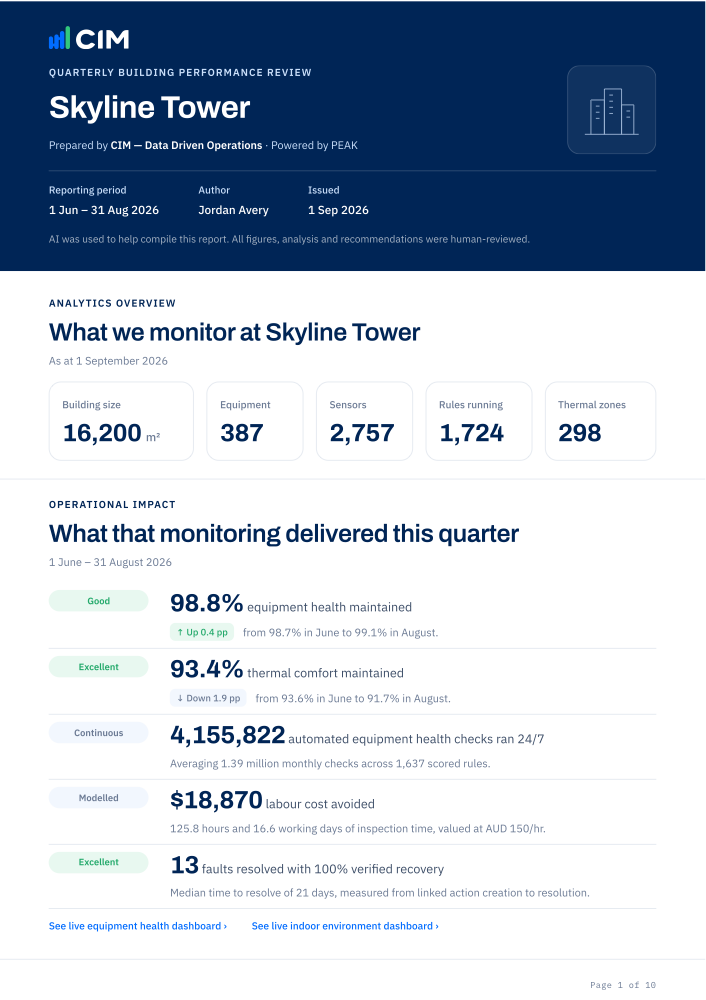
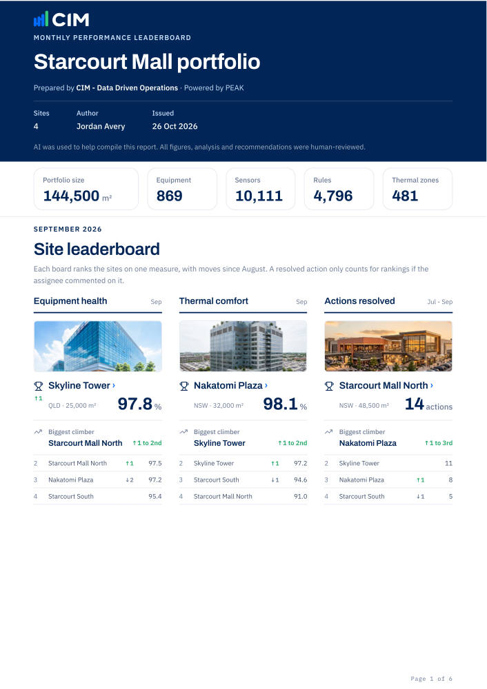

# client-report

A PEAK skill that builds a client-facing building performance report as a print-ready HTML page: a quarterly review for one site, or a monthly performance leaderboard across a client's portfolio.

| Site quarterly review | Portfolio leaderboard |
| --- | --- |
| [](docs/site-report.pdf) | [](docs/portfolio.pdf) |

## Install

1. Connect PEAK to your AI assistant, which the skill needs: [PEAK AI Connector (MCP)](https://support.cim.io/en/articles/14883828-peak-ai-connector-mcp)
2. On this page, click **Code > Download ZIP**
3. Upload that one zip as a skill: Claude **Customize > Skills**, ChatGPT **Plugins > Skills**, Copilot Studio **Build > Skills**

## Use

```
/client-report <site name>
/client-report <client name> portfolio
```

## Releases

- **13 Aug 2026**: First release. Equipment health, thermal comfort, actions leaderboard and key wins
- **15 Oct 2026**: Equipment run hours, and photos in key wins
- **19 Oct 2026**: Sustainability ratings
- **26 Oct 2026**: Portfolio leaderboard
